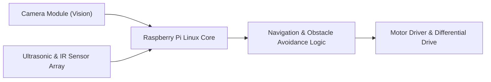

# Raspberry Pi Autonomous Rover Platform

Embedded robotics platform built on **Raspberry Pi** and **Linux**, integrating live camera vision, multi-sensor obstacle detection, and closed-loop motor control toward autonomous navigation.

---

## 1. System Architecture

---

## 2. Raspberry Pi & Linux Environment Setup

- **Operating System:** Headless **Debian / Raspberry Pi OS** configured for SSH remote telemetry, GPIO permissions, and hardware I2C/SPI/CSI interfaces.
- **Service Isolation:** Modular daemonized processes separating sensor polling, camera frame capture, and motor actuation loops.

---

## 3. Camera Vision & Multi-Sensor Integration

- **Camera Vision Pipeline:** Streams forward-facing camera frames for lane/marker tracking and visual navigation experiments.
- **Distance & Proximity Sensing:** Combines front/side ultrasonic rangefinders and IR modules via GPIO/I2C to detect obstacles and trigger avoidance maneuvers.
- **Sensor Fusion Loop:** Aggregates timestamped sensor readings with visual cues for safe path planning.

---

## 4. Motor Control & Actuation Architecture

- **Differential Drive Chassis:** Dual-channel H-bridge motor driver controlled via hardware PWM signals from the Raspberry Pi GPIO header.
- **Safety Watchdog:** Automatic motor cut-off on sensor timeout, emergency stop command, or loss of control heartbeat.
